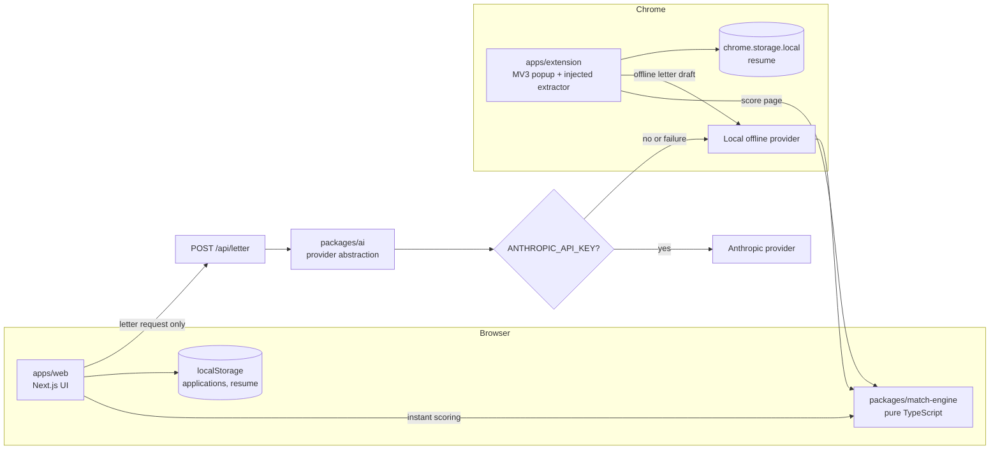

# Waypoint

**Know your odds before you apply.** A job-application tracker that scores your resume against every posting, shows exactly which skills are missing, and drafts a tailored cover letter.

[](https://github.com/Zoriyonz/waypoint-job-tracker/actions/workflows/ci.yml)
[](LICENSE)


Waypoint runs entirely in the browser with no account and no API key. Add an Anthropic key and cover letters come from Claude instead of the built-in offline writer.

## Contents

- [Overview](#overview)
- [Features](#features)
- [Architecture](#architecture)
- [The Chrome extension](#the-chrome-extension)
- [How the score works](#how-the-score-works)
- [Tech stack](#tech-stack)
- [Project structure](#project-structure)
- [Getting started](#getting-started)
- [Configuration](#configuration)
- [Scripts](#scripts)
- [Testing and quality gates](#testing-and-quality-gates)
- [Privacy and security](#privacy-and-security)
- [Design decisions](#design-decisions)
- [Limitations](#limitations)
- [Roadmap](#roadmap)
- [License](#license)

## Overview

Job searching generates a pile of postings and one resume. The useful question for each posting is "how well do I match, and what is missing?" Waypoint answers it with a transparent, deterministic scoring engine instead of a black box, and keeps your applications on a kanban board so you can see where each one stands.

Waypoint is a Turborepo monorepo with **two apps on one engine**: the [web board](#architecture) and a [Chrome extension](#the-chrome-extension) that scores whatever posting you have open. Both call the same `match-engine` and `ai` packages.

## Features

- **Kanban board** with drag-and-drop stages: Wishlist, Applied, Interview, Offer, Closed.
- **Live match score** that updates as you edit your resume or paste a job description.
- **Transparent breakdown:** skills coverage, language relevance and quantified impact, with matched and missing skills listed.
- **Required versus nice-to-have detection** from the posting's own section headings.
- **Cover letters grounded in your resume.** The offline writer only mentions skills the engine actually found, and the Claude prompt is built to avoid inventing facts.
- **Local-first.** Data lives in `localStorage`. A resume only leaves the browser if you request a hosted-model letter.

## Architecture



```
waypoint/
├── apps/
│   ├── web                   Next.js 16 (App Router), React 19, Tailwind v4
│   └── extension             Manifest V3 Chrome extension, bundled with esbuild
└── packages/
    ├── match-engine          Pure TypeScript scoring engine (no dependencies)
    └── ai                    Provider abstraction: offline engine or Anthropic API
```

- **`match-engine`** is framework-free and fully unit tested. It extracts skills from a curated taxonomy, splits required from nice-to-have, computes cosine similarity with sublinear term frequency, and counts quantified achievements.
- **`ai`** defines an `AIProvider` interface. The Anthropic provider is used only when `ANTHROPIC_API_KEY` is set, and any failure degrades gracefully to the offline provider.
- **`apps/extension`** reads the job posting in the active tab and scores it with the same engine, locally.
- **`apps/web`** calls the engine directly in the browser for instant scoring, and calls `/api/letter` only for letter generation, so the key never reaches the client.

### Why a monorepo

- **One scoring engine, two products.** A posting scores identically on the board and in the extension because both import `@waypoint/match-engine`. There is no second implementation to drift.
- **Shared letter logic.** The extension's cover letter draft uses the same offline provider as the web app, so it only ever mentions skills found in the resume.
- **Different runtimes, one toolchain.** A Next.js app and a browser extension are linted, type-checked, tested and built by the same `pnpm` and Turborepo commands in one CI job.

## The Chrome extension

Open a job posting, click the Waypoint icon, and get a score, the required and nice-to-have skills you show or lack, and suggestions. Optionally copy an offline cover letter draft.

```bash
pnpm --filter @waypoint/extension build
# then chrome://extensions → enable Developer mode → Load unpacked → apps/extension/dist
```

- **Minimal permissions.** `activeTab`, `scripting` and `storage` only: no host permissions, no always-on content script, no background worker. The extractor is injected only when you click the icon.
- **Local only.** Your resume is stored in `chrome.storage.local`. The extension makes no network requests and has no API key; the cover letter draft is the offline provider.
- **Reads postings robustly.** It tries the page's schema.org `JobPosting` data first, then known applicant-tracking-system containers, then the page text, and tells you which was used so you know how much to trust the score.
- **Treats pages as untrusted.** Descriptions are parsed with `DOMParser` (an inert document) and rendered with `textContent`, so markup in a posting can never run or load anything. This is covered by tests.
- **Verified in a real browser.** Besides 26 unit tests, the built extension was loaded into Chrome and driven end to end (save resume, reload, score a posting).

## How the score works

`score = 100 × (0.60 × skills + 0.25 × relevance + 0.15 × impact)`

| Signal    | What it measures                                                        |
| --------- | ----------------------------------------------------------------------- |
| Skills    | Required skills matched, with nice-to-haves at half weight              |
| Relevance | Cosine similarity between resume and posting, rescaled                  |
| Impact    | Count of quantified results (percentages, users, dollars) in the resume |

Skills come from a curated taxonomy of about 58 canonical skills with aliases (for example `Node.js` also matches `nodejs`), matched on word boundaries so a skill never matches inside another word, and with symbols like `C++` and `C#` handled explicitly.

The weights are heuristics, not a prediction of hiring outcomes. Treat the score as a prompt to tailor your resume.

## Tech stack

| Area      | Choice                                                  |
| --------- | ------------------------------------------------------- |
| Framework | Next.js 16 (App Router), React 19                       |
| Language  | TypeScript 5 in strict mode                             |
| Styling   | Tailwind CSS 4                                          |
| Monorepo  | pnpm workspaces and Turborepo                           |
| AI        | Anthropic Messages API (optional), plain `fetch`        |
| Testing   | Vitest                                                  |
| Quality   | ESLint (`eslint-config-next`), Prettier, GitHub Actions |
| Packages  | pnpm 10, Node 20 or newer (`.nvmrc` pins 22)            |

## Project structure

```
waypoint-job-tracker/
├── apps/
│   ├── web/
│   │   └── src/
│   │       ├── app/             Pages: / and /board, and POST /api/letter
│   │       ├── components/      Board, JobDrawer, ScoreRing
│   │       └── lib/             store (local-first state), seed data, types
│   └── extension/
│       ├── public/              manifest.json, popup.html, popup.css, icons
│       ├── src/                 extract.ts (page reader), popup.ts (UI), content.ts, chromeApi.ts
│       └── scripts/build.mjs    esbuild bundle into dist/
├── packages/
│   ├── match-engine/src/        analyze, skills taxonomy, text helpers (+ tests)
│   └── ai/src/                  providers: local and anthropic (+ tests)
├── .github/workflows/ci.yml     Format, lint, typecheck, test, build
├── turbo.json, pnpm-workspace.yaml, tsconfig.base.json
└── .editorconfig, .prettierrc.json, .nvmrc, LICENSE
```

## Getting started

Requires Node 20 or newer and [pnpm](https://pnpm.io) 10.

```bash
git clone https://github.com/Zoriyonz/waypoint-job-tracker.git
cd waypoint-job-tracker
pnpm install
pnpm dev                       # http://localhost:3000
```

The board opens with sample applications so you can try scoring immediately.

### Optional: Claude-written letters

```bash
cp apps/web/.env.example apps/web/.env.local
# then set ANTHROPIC_API_KEY in apps/web/.env.local
```

## Configuration

| Variable            | Required | Purpose                                                   |
| ------------------- | -------- | --------------------------------------------------------- |
| `ANTHROPIC_API_KEY` | No       | Switches cover letters from the offline writer to Claude. |
| `ANTHROPIC_MODEL`   | No       | Overrides the default model.                              |

## Scripts

Run from the repository root.

| Command             | What it does                                    |
| ------------------- | ----------------------------------------------- |
| `pnpm dev`          | Start the web app                               |
| `pnpm build`        | Build everything through Turborepo              |
| `pnpm lint`         | ESLint (web and extension)                      |
| `pnpm typecheck`    | `tsc --noEmit` in every package                 |
| `pnpm test`         | Unit tests for all packages and apps (41 total) |
| `pnpm format`       | Format everything with Prettier                 |
| `pnpm format:check` | Fail if anything is not formatted (used in CI)  |

## Testing and quality gates

41 tests run offline: 15 in the two packages and 26 in the extension. The match engine's 10 tests cover alias-based skill extraction, no matches inside other words, symbol skills like C++ and C#, required versus nice-to-have splitting, matched and missing skills, score bounds and ordering (a better resume scores higher), evidence suggestions for missing skills, neutral scoring when a posting names no skills, cosine similarity edge cases and quantified-achievement counting. The AI package's 5 tests cover provider selection, letters that only claim skills found in the resume, and fallback to the offline provider when the hosted API fails. The extension's 26 tests cover page extraction (structured data, ATS selectors, fallbacks, length caps and inert handling of hostile markup), the popup flow against an injected browser API, and manifest guarantees such as minimal permissions, no always-on scripts and a strict content security policy.

CI runs `format:check`, `lint`, `typecheck`, `test` and `build` on every push and pull request.

## Privacy and security

- Applications and the resume are stored only in your browser's `localStorage`.
- A resume is sent to the server only when you ask for a cover letter, and only to Anthropic if you configured a key.
- `/api/letter` rejects malformed JSON, requires non-empty `resume`, `jobDescription`, `company` and `role` strings, and caps each at 20,000 characters.
- The API key is read only on the server.

## Design decisions

- **A deterministic score you can read.** Every point comes from a named signal, so users can see why a posting scored the way it did.
- **Offline by default.** The local cover-letter provider makes the whole product work with zero configuration, and it only mentions skills it found in the resume.
- **A provider interface for AI.** Swapping or adding a model means implementing one interface, and failures fall back instead of surfacing errors.
- **A framework-free engine package.** `match-engine` imports nothing from React or Next.js.

## Limitations

- **The score is a heuristic.** It rewards keyword and phrase overlap and does not understand seniority, context or hiring practices.
- **The skills taxonomy is small and curated.** Skills outside it are not counted.
- **Data lives in one browser,** so clearing site data or switching devices loses it.
- **No rate limiting** on `/api/letter`. With a key configured, a public deployment would need one.
- **Resume input is pasted text,** not an uploaded file.

## Roadmap

- Resume file upload (PDF) with parsing
- Sync across devices with a hosted database behind the same store interface
- Interview-prep checklist generated from missing skills

## License

[MIT](LICENSE) © 2026 Zoriyon Zion
